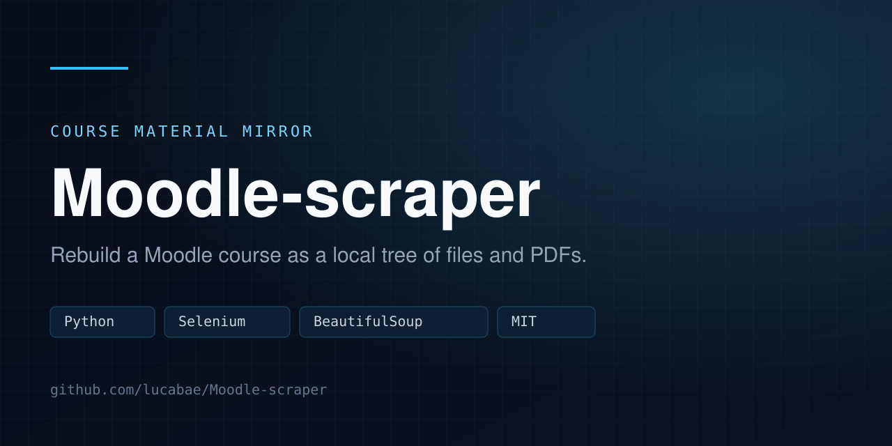
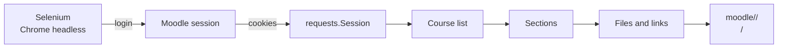

<div align="center">
  
</div>

# Moodle-scraper

Command-line scraper for the Moodle instance at `moodle.upm.es`. It logs in with a real session, walks every enrolled course, and mirrors the course structure as a local folder tree with the downloadable material (PDFs and other files).

Forked from [NelBruh/Moodle-scraper](https://github.com/NelBruh/Moodle-scraper), adapted to the UPM instance. The original MIT license and copyright are kept in [LICENSE](LICENSE).

## What it does

- Logs in through Selenium, including the UPM single sign-on flow.
- Reuses the browser session cookies for `requests`, so downloads are fast.
- Creates one folder per course and one subfolder per section.
- Downloads PDFs and linked files, overwriting duplicates instead of failing.
- Skips what it cannot parse instead of aborting the whole run.

## How it works



## Requirements

- Python 3.10+
- Google Chrome installed (Selenium Manager resolves the driver)
- Python packages: `selenium`, `beautifulsoup4`, `requests`, `python-dotenv`
- A UPM Moodle account with access to the courses you want to download

```bash
python3 -m venv venv
venv/bin/pip install selenium beautifulsoup4 requests python-dotenv
```

## Usage

```bash
git clone https://github.com/lucabae/Moodle-scraper.git
cd Moodle-scraper
cp .env.example .env
```

Fill `.env`:

```
usuario=your_moodle_username
pw=your_moodle_password
```

Then run:

```bash
venv/bin/python main.py
```

The output is written to `./moodle/`:

```
moodle/
  Course name/
    Section name/
      file.pdf
```

## Configuration

| File | Purpose |
|---|---|
| `.env` | Moodle credentials (`usuario`, `pw`). Git-ignored, never commit it. |
| `.env.example` | Template with empty values. |

Credentials are read from `.env` at runtime and are never written to logs or to the output tree.

## Limits

- Only content the account can already see is downloaded.
- Sections with embedded sub-sections are not traversed yet.
- The layout of `moodle.upm.es` can change at any time and break the selectors.
- Large courses take a while; the scraper waits on real network requests.

## Roadmap

- Support links embedded in sub-sections.
- Support nested folders inside sections.
- Organize sections into sub-folders.

## Responsible use

Use it only with your own account and only for material you are allowed to download. Do not redistribute course content. Respect the university's terms of service and do not run it at a rate that degrades the service.

## License

MIT. Original work Copyright (c) 2026 NelBruh. See [LICENSE](LICENSE).
